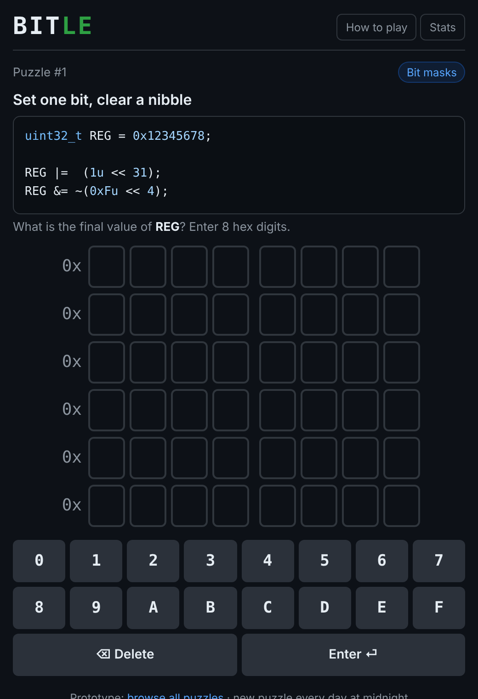

# Bitle ⚡ the daily embedded puzzle

**Wordle, but for embedded engineers.** Every day there's a new short piece of embedded C. Work out the final 32-bit value of `REG`, type it as 8 hex digits, and you get 6 tries.

▶️ **Play:** https://rakeshreddyb37.github.io/Bitle/



## How it works

| Colour | Meaning |
|---|---|
| 🟩 | Right hex digit, right position |
| 🟨 | Digit is in the answer, but somewhere else |
| ⬛ | Digit is not in the answer |

Win or lose, you get a short explanation of the idea behind the puzzle: bit masks, integer promotion, timer math, CAN mailboxes, struct padding and more. Share your grid (no spoilers) with the **Copy result** button.

Puzzles assume a 32-bit ARM Cortex-M (32-bit `int`, little-endian, standard alignment) unless they say otherwise.

## Contribute a puzzle

Got a favourite embedded gotcha? Add it! See [CONTRIBUTING.md](CONTRIBUTING.md). Every puzzle is checked automatically, so a wrong answer can't go live.

## Run locally

It's a static site with no build step. Open `index.html` in a browser, or:

```bash
python3 -m http.server 8000   # then open http://localhost:8000
node tests/check-puzzles.js   # verify all puzzle answers
```

## License

MIT, see [LICENSE](LICENSE).
